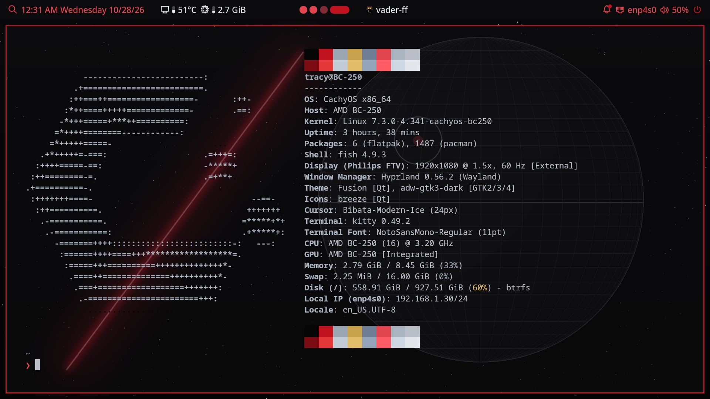
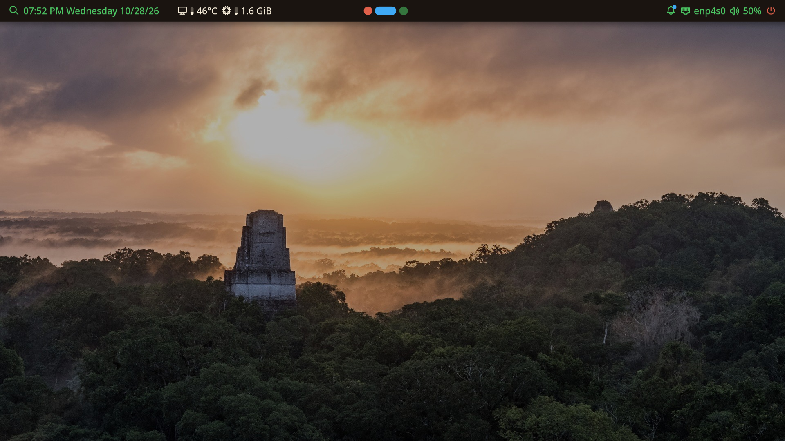
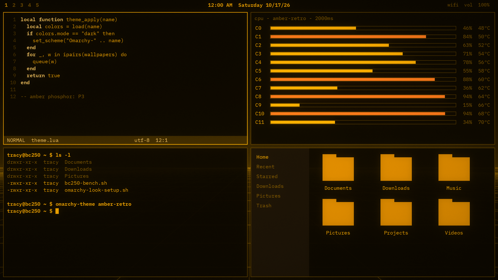
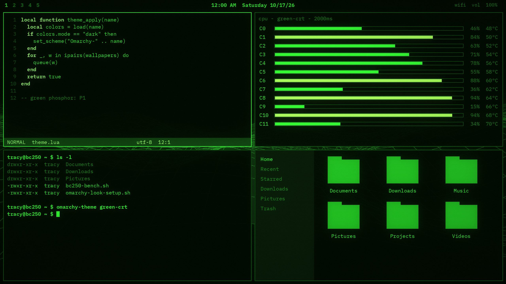

# omarchy-bc250-setup

Turns a fresh **Omarchy** install — Omarchy on vanilla Arch Linux, from the official Omarchy ISO — into the AMD BC-250 setup used on the working machine. That machine runs CachyOS package repositories, the BC-250 CachyOS kernel and patched Mesa, the Cyan Skillfish GPU governor, CEC, dual audio, a CU boot profile, a thermal guard, and four custom Omarchy themes.

This was not run on a BC-250. There is no board in this environment, so the script is syntax-checked and the repository edits are unit-tested, not hardware-tested.

## Requirements

- A fresh Omarchy install on Arch Linux (not a CachyOS ISO install).
- The AMD BC-250 (Zen 2, x86-64-v3, GFX1013 / Cyan Skillfish).
- A network connection, `sudo`, and several gigabytes free. The two Proton packages are about 3 GB together, and the GPU governor compiles from the AUR.
- Run the script as your normal user. It calls `sudo` itself.

## Run it

```
git clone https://github.com/hemingwaytiger/omarchy-bc250-setup.git
cd omarchy-bc250-setup
./install.sh
```

Run it again any time. It backs up a file before changing it (`file.bak-YYYYMMDD-HHMMSS`) and leaves a file alone when the new copy matches. Re-running also disables `bc250-smu-oc` again.

## What each step changes

### 1. Check the install

Confirms this is x86_64 Arch and that Omarchy is present. `--force` skips the Omarchy check. Installs `python` if it is missing, because the config edits use it.

### 2. Package repositories

Backs up `/etc/pacman.conf`, then writes the same repository order as the working machine.

CachyOS is installed the official way: import key `F3B607488DB35A47`, locally sign it, and install `cachyos-keyring`, `cachyos-mirrorlist`, and (when the CPU supports it) `cachyos-v3-mirrorlist` from `https://mirror.cachyos.org`. Arch's own `pacman` is kept. The CachyOS helper can also replace `pacman`; this setup does not.

The CPU check is the one CachyOS uses (`x86-64-v3 (supported, searched)` from the dynamic linker). A BC-250 passes it. If a machine does not, the v3 repositories are left out and only the generic `[cachyos]` repo is added.

`[bc250-cachyos]` is unsigned, so it uses `SigLevel = Optional TrustAll`, the same setting as the working machine. That trusts the packages published at `https://github.com/MastaG/linux-cachyos-bc250`. The CachyOS repositories stay on the normal signature check.

Order on a v3 CPU, matching `reference/pacman.conf.txt`:

```
[bc250-cachyos]
SigLevel = Optional TrustAll
Server = https://github.com/MastaG/linux-cachyos-bc250/releases/download/repo

[cachyos-v3]
Include = /etc/pacman.d/cachyos-v3-mirrorlist

[cachyos-extra-v3]
Include = /etc/pacman.d/cachyos-v3-mirrorlist

[cachyos-core-v3]
Include = /etc/pacman.d/cachyos-v3-mirrorlist

[cachyos]
Include = /etc/pacman.d/cachyos-mirrorlist

[core]
Include = /etc/pacman.d/mirrorlist

[extra]
Include = /etc/pacman.d/mirrorlist

[multilib]
Include = /etc/pacman.d/mirrorlist
```

`[multilib]` is uncommented when it is still commented. `[core]`, `[extra]`, and `[multilib]` stay below the CachyOS repositories. The first system upgrade moves packages that exist in those repositories onto the CachyOS builds. That is what the working machine runs.

### 3. Kernel, Mesa, audio, CEC, and Proton

Installs, from `[bc250-cachyos]` when that repository has the package:

| Package | Role |
| --- | --- |
| `linux-cachyos-bc250` and headers | Stable BC-250 kernel from [MastaG/linux-cachyos-bc250](https://github.com/MastaG/linux-cachyos-bc250). The Omarchy kernel stays installed as a fallback boot entry. |
| `mesa`, `lib32-mesa`, `vulkan-radeon`, `lib32-vulkan-radeon` | Patched Mesa / RADV for GFX1013, including the BC-250 async-compute and FSR4 work. |
| `bc250-cec` | HDMI CEC: identify as SteamOS and retrain the display link. [Upstream](https://github.com/MastaG/linux-cachyos-bc250). |
| `bc250-dual-audio` | HDMI/DP plus a switchable Dolby Digital 5.1 sink. [Upstream](https://github.com/MastaG/bc250-dual-audio). |
| `proton-cachyos-native-bc250` | CachyOS Proton built for Zen 2, with FSR4. |
| `protonge-latest-bc250` | GE-Proton packed for this board. |

Also installs Steam, gamemode, firmware, `amd-ucode`, and the small tools those packages depend on (`v4l-utils`, `python-evdev`, PipeWire, `mesa-utils`, `vulkan-tools`).

Not installed, because the working machine's explicit package list does not include them: `bc250-fixes` (CachyOS handheld / Steam Deck session tweaks) and `proton-cachyos-slr-bc250` (the anti-cheat Steam Linux Runtime build).

If `bc250-cec` cannot be installed from the repository, the script copies the bundled 1-17 files under `system/cec/`. Those match the package on the working machine (GPL-2.0-only).

### 4. yay, umr, and the GPU governor

Installs [yay](https://aur.archlinux.org/packages/yay) if it is missing. paru is not used.

Then builds two AUR packages:

- `umr` (or `umr-git` if `umr` fails), the register tool the CU manager uses.
- `cyan-skillfish-governor-smu` 0.4.14, the same version as the working machine. Upstream: [filippor/cyan-skillfish-governor](https://github.com/filippor/cyan-skillfish-governor/tree/smu), branch `smu`.

### 5. Command line, swappiness, fan driver

Appends the working machine's BC-250 parameters. It does not copy that machine's `root=` UUID or `rootflags=`.

On Omarchy this is a single `KERNEL_CMDLINE[default]+=` line in `/etc/default/limine`, which appends to Omarchy's Limine drop-in. The script then runs `limine-update` or `limine-mkinitcpio`. systemd-boot and GRUB are handled if Limine is not installed.

Parameters:

- `nowatchdog`
- `systemd.zram=0`
- `zswap.enabled=1`
- `zswap.max_pool_percent=25`
- `zswap.compressor=lz4`
- `ttm.pages_limit=3145728` (12 GiB of GTT)
- `amdgpu.vm_update_mode=3`
- `amdgpu.cs_eight_core_map=1` only when the installed kernel module still has that parameter

Current BC-250 kernels choose 6-core or 8-core telemetry themselves. Passing a parameter the module does not know can stop `amdgpu` from loading, so the script checks `modinfo` and skips the parameter when it is gone.

Also installs `/etc/sysctl.d/99-swappiness.conf` (`vm.swappiness = 60`) and `/etc/modules-load.d/nct6687.conf` so the kernel's NCT6687 fan and temperature driver loads. `bc250_memory` (GDDR6 temperatures) stays off, which is the kernel default.

### 6. GPU governor configuration

Copies the working machine's `/etc/cyan-skillfish-governor-smu/config.toml` (clock range 1000–1850 MHz and the saved voltage points) and enables `cyan-skillfish-governor-smu.service`. The AUR package marks that file as a pacman backup, so a later package update will not overwrite it.

### 7. CU manager, thermal guard, CEC, and the CPU overclock

| Piece | What happens |
| --- | --- |
| `bc250-cu-live-manager` | Installed to `/usr/local/bin` and enabled. At boot it applies `BC250_WGP_MASKS=0x1f,0x1f,0x1f,0x1f` through `umr`, which is the working machine's full 40 CU profile. That raises power draw and heat. |
| `bc250-thermal-guard` | Enabled. Lowers the governor's max GPU clock when Tctl is hot. It does not change CPU clocks or voltages. |
| `bc250-cec` | Enabled when the unit is installed. |
| `bc250-smu-oc` | Config, `bc250_apply.py`, and a systemd unit are installed. The unit is **disabled** and is disabled again on every re-run. It is a CPU overclock (3500 MHz, scale -34, 90 °C on the working machine). The `bc250_smu` Python package is not installed, so the unit cannot run until you install [bc250_smu_oc](https://github.com/bc250-collective/bc250_smu_oc) yourself. |

CPU core unlock and the 8-core SMU firmware patch are not applied. The working request was to leave the CPU alone.

### 8. Themes

Copies Vader, Jedi, Amber Retro, and Green CRT to `~/.config/omarchy/themes/`. That is the directory the current theme picker reads for your themes, and it survives `omarchy-update`.

`~/.local/share/omarchy/themes/` is Omarchy's own git checkout. Writing there gets wiped or blocks the next update, so the script copies there only when that tree is not a git checkout. Colors and the rest of each theme are copied unchanged. The script does not switch the active theme.

### 9. update-all

Installs `/usr/local/bin/update-all`. It runs `pacman`, then `yay`, then Omarchy's updater, then Flatpak when those tools exist.

```
update-all
```

## After it finishes

Reboot. If Limine does not already highlight `linux-cachyos-bc250`, choose that entry once. Confirm:

```
uname -r
lsmod | grep nct6687
vulkaninfo --summary
```

`uname -r` should contain `cachyos-bc250`.

In Steam, choose `proton-cachyos-native-bc250` or `protonge-latest-bc250` per game. The packages show up as compatibility tools; they do not change Steam's global default.

For the Dolby Digital sink without a reboot:

```
systemctl --user restart pipewire pipewire-pulse wireplumber
```

`bc250-dual-audio` is tested upstream against WirePlumber 0.5.17. The package prints a warning if the installed WirePlumber is different. HDMI audio still works; AC3 switching may not until that package is rebuilt for the newer WirePlumber.

## Themes

Pick one from Omarchy's theme menu.

### Vader

Near-black with a crimson accent (`#C1121F`). Icon name in the theme: `Yaru-red`.



Wallpapers are credited in `themes/vader/backgrounds/CREDITS.txt`:

| File | Credit |
| --- | --- |
| `1-lava-field-night.jpg` | incidencematrix, [CC BY 2.0](https://creativecommons.org/licenses/by/2.0), [source](https://commons.wikimedia.org/wiki/File:Eruption_at_Night_-_Flickr_-_incidencematrix.jpg) |
| `2-red-spider-nebula.jpg` | ESA/Hubble & NASA, G. Mellema, [CC BY 4.0](https://creativecommons.org/licenses/by/4.0), [source](https://commons.wikimedia.org/wiki/File:Red_Spider_Nebula_NGC_6537_(Hubble%E2%80%99s_view)_(potm2510c).jpg) |
| `3-halemaumau-night.jpg` | National Park Service / Keith Burnett, public domain, [source](https://commons.wikimedia.org/wiki/File:Halema%E2%80%98uma%E2%80%98u_from_Jaggar_Museum_at_night.jpg) |
| `4-painted-smoky-hall.jpg` | Original painted scene made for this theme |
| `5-painted-red-planet-station.jpg` | Original painted scene made for this theme |

### Jedi

Warm sand and cream with a blue accent (`#3FA9F5`). Icon name: `Yaru-blue`.



Wallpapers are credited in `themes/jedi/backgrounds/CREDITS.txt`:

| File | Credit |
| --- | --- |
| `1-tikal-sunrise.jpg` | USAID Biodiversity & Forestry, public domain, [source](https://commons.wikimedia.org/wiki/File:USAID_Measuring_Impact_Conservation_Enterprise_Retrospective_(Guatemala;_Rainforest_Alliance)_(26431867928).jpg) |
| `2-erg-chebbi-sunset.jpg` | Thomas Fuhrmann, [CC BY-SA 4.0](https://creativecommons.org/licenses/by-sa/4.0), [source](https://commons.wikimedia.org/wiki/File:Erg_Chebbi_sunset.jpg) |
| `3-misty-forest.jpg` | Jason Conzett, [CC BY-SA 4.0](https://creativecommons.org/licenses/by-sa/4.0), [source](https://commons.wikimedia.org/wiki/File:Misty_Forest_Schnebelhorn.jpg) |
| `4-painted-temple-dusk.jpg` | Original painted scene made for this theme |
| `5-painted-twin-suns-homestead.jpg` | Original painted scene made for this theme |

### Amber Retro

Amber phosphor on black (`#FFB000`). Icon name: `Yaru-yellow`. The theme has no `CREDITS.txt`. The four wallpapers shipped with it are original generated images (phosphor grid, terminal, oscilloscope, sunset).



### Green CRT

Green phosphor on black (`#33FF33`). Icon name: `Yaru-sage`. No `CREDITS.txt`. The four wallpapers are original generated images (code rain, radar sweep, boot terminal, vector landscape).



`icons.theme` only names an icon theme. Yaru is not installed by this script. The palette, terminal, btop, and Hyprland colors still apply without it.

## Undo

```
./uninstall.sh
```

That disables the services, removes kernel parameters this setup added, and deletes local files and themes that still match this repository. `/etc/pacman.conf` is left alone so the machine stays on the repositories you just installed.

To drop `[bc250-cachyos]` and the CachyOS blocks as well (this also backs up `pacman.conf` first):

```
./uninstall.sh --repos
```

Packages stay installed either way. Boot an Omarchy kernel entry before removing the BC-250 kernel, then:

```
sudo pacman -Rns linux-cachyos-bc250 linux-cachyos-bc250-headers bc250-cec bc250-dual-audio proton-cachyos-native-bc250 protonge-latest-bc250 cyan-skillfish-governor-smu umr
sudo pacman -S extra/mesa extra/vulkan-radeon multilib/lib32-mesa multilib/lib32-vulkan-radeon
```

Timestamped `.bak-*` copies are the other way back. Restore one with `sudo cp`, then rebuild boot entries with `sudo limine-update` if you restored a command line.

To stop only the full CU profile:

```
sudo systemctl disable --now bc250-cu-live-manager.service
```

## What this does not do

- It does not enable or install a working CPU overclock. `bc250-smu-oc` stays disabled, and the `bc250_smu` module is not installed.
- It does not unlock CPU cores or patch SMU firmware.
- It does not turn on `amdgpu.bc250_cc_write_mode`. The 40 CU profile is the umr boot service the working machine uses, not that kernel parameter.
- It does not replace Arch's `pacman` with the CachyOS `pacman` build.
- It was not tested on a BC-250. Confirm the kernel, `nct6687`, and Vulkan after the first reboot.

## Layout

```
install.sh                 entry point
uninstall.sh               undo local changes; --repos drops repo blocks
bin/update-all             pacman, yay, Omarchy, Flatpak
lib/common.sh              backups and logging
lib/edit_configs.py        pacman.conf and kernel command-line edits
system/                    configs, services, CU manager, thermal guard
system/cec/                bc250-cec 1-17 fallback (same files as the package)
system/cmdline/params.txt  parameters added to the kernel command line
themes/                    vader, jedi, amber-retro, green-crt
reference/                 captured package list and pacman.conf from the working machine
tests/test_edits.py        repository-order and command-line tests
tests/lint.sh              shellcheck, bash -n, and those tests
```

Check the scripts locally with:

```
./tests/lint.sh
```
